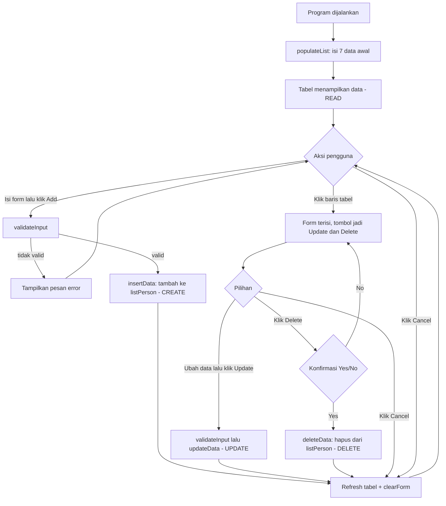

# PeopleData – Manajemen Data Sekolah (Java Swing)
 
Aplikasi CRUD (Create, Read, Update, Delete) berbasis Java Swing dengan tema **People** pada konteks **sekolah**. Struktur kode mengikuti latihan ProductData: class model (`Person`), class GUI (`PeopleMenu`), dan file form IntelliJ GUI Designer (`PeopleMenu.form`).

## Janji

```
Saya Mohammad Arya Dhinata dengan NIM 2504992 mengerjakan Tugas Praktikum 4 dalam mata kuliah Desain
Pemrograman Berbasis Objek untuk keberkahan-Nya maka saya tidak melakukan kecurangan seperti
yang di spesifikasikan. Aamiin
```
 
## 1. Desain dan Fungsi Program
 
### Fungsi
Program menyimpan data warga sekolah (siswa, guru, staf, dll.) dalam sebuah `ArrayList<Person>` dan menampilkannya pada tabel. Pengguna dapat menambah, melihat, mengubah, dan menghapus data lewat form di atas tabel.
 
### Atribut Data (class `Person`)
 
| Atribut | Tipe | Komponen pada Form | Keterangan |
|---|---|---|---|
| `id` | String | `JTextField` (`idField`) | Contoh: S001, G001 |
| `nama` | String | `JTextField` (`namaField`) | |
| `tahunLahir` | int | `JTextField` (`tahunLahirField`) | Harus angka |
| `kategori` | String | `JComboBox` (`kategoriComboBox`) | Siswa, Guru, Staf TU, Kepala Sekolah, Alumni |
| `jenisKelamin` *(atribut baru)* | String | `JRadioButton` (`lakiRadio`, `perempuanRadio`) dalam `ButtonGroup` | Laki-laki / Perempuan (**bonus: bukan JTextField**) |
 
### Desain Tampilan (`PeopleMenu.form`)
 
```
+--------------------------------------------------+
|                  Data Sekolah  (titleLabel)      |
| ID:           [ idField                        ] |
| Nama:         [ namaField                      ] |
| Tahun Lahir:  [ tahunLahirField                ] |
| Kategori:     [ kategoriComboBox             v ] |
| Jenis Kelamin: (o) Laki-laki  (o) Perempuan      |
| [ Add/Update ] [ Delete ] [ Cancel ]             |
| +----------------------------------------------+ |
| | No | ID | Nama | Tahun Lahir | Kategori | JK | |
| |            peopleTable                       | |
| +----------------------------------------------+ |
+--------------------------------------------------+
```
 
| Komponen | Fungsi |
|---|---|
| `addUpdateButton` | Berlabel **Add** saat mode tambah, berubah menjadi **Update** saat sebuah baris dipilih |
| `deleteButton` | Hanya tampil saat baris dipilih; menghapus data setelah konfirmasi |
| `cancelButton` | Mengosongkan form dan membatalkan pilihan baris |
| `peopleTable` | Menampilkan seluruh data; klik baris untuk memuat data ke form |
 
### Fitur Tambahan
- **Confirmation prompt** sebelum data dihapus ("Apakah Anda yakin ingin menghapus data ini?").
- **Validasi input**: ID dan Nama wajib diisi, tahun lahir harus angka, kategori dan jenis kelamin wajib dipilih.
- Tabel tidak dapat diedit langsung (`isCellEditable` = false).
### Method Utama (`PeopleMenu.java`)
 
| Method | Fungsi |
|---|---|
| `populateList()` | Mengisi 7 data awal ke `listPerson` |
| `setTable()` | Membuat `DefaultTableModel` dari `listPerson` untuk ditampilkan di tabel |
| `validateInput()` | Memeriksa isi form, mengembalikan pesan error atau `null` jika valid |
| `insertData()` | **Create**: menambah `Person` baru ke `listPerson` |
| `updateData()` | **Update**: mengubah data `Person` pada indeks yang dipilih |
| `deleteData()` | **Delete**: menghapus `Person` pada indeks yang dipilih |
| `clearForm()` | Mengembalikan form ke kondisi awal (mode Add) |
 
## 2. Penjelasan Alur
 
### Alur Umum
 

 
### Alur Tiap Operasi
 
1. **Create (Add)** – Pengguna mengisi ID, Nama, Tahun Lahir, Kategori, dan Jenis Kelamin, lalu klik **Add**. Input divalidasi, objek `Person` baru ditambahkan ke `listPerson`, tabel diperbarui, dan form dikosongkan.
2. **Read** – Saat program dibuka, seluruh data tampil di tabel. Klik sebuah baris untuk memuat datanya ke form; tombol berubah menjadi **Update** dan **Delete** muncul.
3. **Update** – Setelah baris dipilih, ubah isi form lalu klik **Update**. Data pada indeks yang dipilih diperbarui dan tabel di-refresh.
4. **Delete** – Setelah baris dipilih, klik **Delete**. Muncul dialog konfirmasi; jika memilih **Yes**, data dihapus dari `listPerson` dan tabel di-refresh.
5. **Cancel** – Mengosongkan form dan membatalkan pilihan baris tanpa mengubah data.
## 3. Dokumentasi Program Dijalankan
 
Demo lengkap seluruh operasi CRUD (data uji: **A002 – Masropah Humaya Saefi**):

[Tonton video demo CRUD](Documentation/TP4Doc.mp4)
